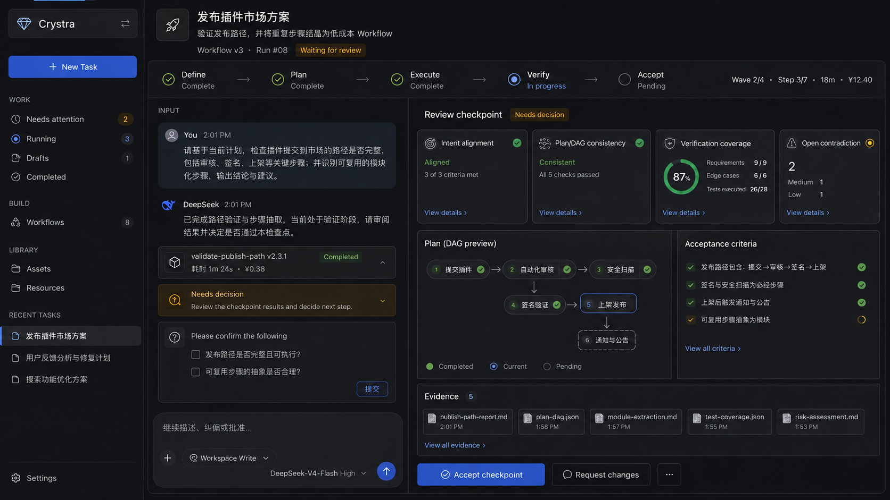
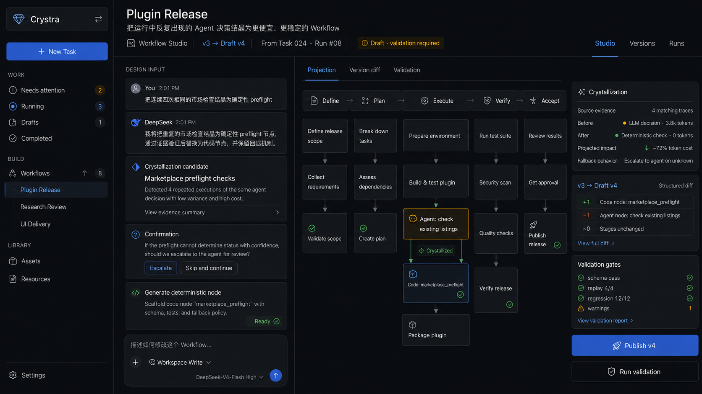
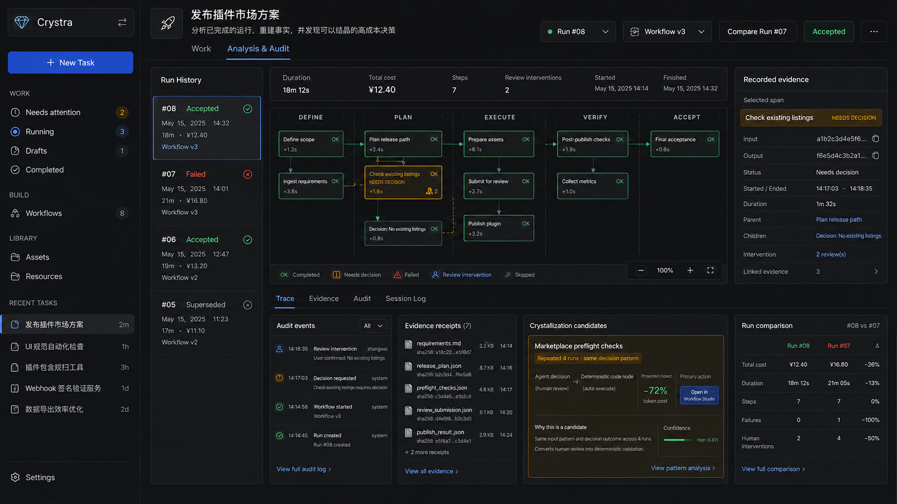

# 资源与设计稿画廊

> 所有原始 PNG/HTML 在 `sources/ui/assets/` 原字节保留。本页解释如何使用；原稿并未按本次冲突处理修改。

## 当前设计稿

[Sidebar 折叠交互 v8](crystra-task-work-v8-sidebar.html)：默认展开，点击品牌右侧按钮折叠；窄图标栏可打开临时目录。[设计说明与验证](../components/shell-and-sidebar.md)。本版使用同目录本地 Tailwind 脚本；下方 v7 仍为来源快照。

## 已接受的字体与颜色资产

[design-system/README.md](design-system/README.md) · [样式表](design-system/index.html) · [变量 JSON](design-system/tokens.json) · [颜色 CSS](design-system/theme.css) · [字体 CSS](design-system/typography.css) · [最终截图](design-system/previews/)。不依赖 Tailwind，不含候选选择器；图标尺寸已纳入批准范围，Iconify 本地资源及通用布局、间距、形状变量均已导出；Header 最终整合仍后置。

## 原稿提取（仅供来源对照）

- [tokens.json](tokens.json) / [tokens.css](tokens.css)：A1 命名颜色、字体、阴影与部分尺寸；U1 最小宽度单独标注。CSS 不等于完整页面样式。
- [task-structure.json](task-structure.json)：A1 静态结构、最近 section 父节点、标签、class 与属性，用于交接定位；不是可执行组件 API。
- [Task DOM 索引](../handoff/task-dom-index.md) / [其他稿件库存](../handoff/other-prototype-index.md)：结构到契约映射。

## 设计稿 v7

| 设计稿 | 用途与限制 |
|---|---|
| [Task Detail](../sources/ui/assets/crystra-task-work-v7.html) | U1 对应权威稿；紧凑尺寸有明确差异，宿主行为和速度演示不代表生产 |
| [Task Browser](../sources/ui/assets/crystra-task-browser-v7.html) | 早期来源快照；当前已审核设计见下方 Task Browser v8，不继承旧 Summary / 字段候选 |
| [Workflow Studio](../sources/ui/assets/crystra-workflow-studio-v7.html) | 允许拓扑、Input、diff/validation 布局；旧 Shell 与写按钮见 C02/C04 |
| [Analysis & Audit](../sources/ui/assets/crystra-analysis-audit-v7.html) | 事实检查布局方向；示例指标/阶段图需系统 owner 校准 |

原稿依赖远程 Tailwind CDN，字体由本机/系统回退；不是离线自包含页面。`data-section-id` 和相对 HTML 深链在快照内保持不变。身份样例不是后台真实数据。历史 [layout.test.mjs](../sources/ui/assets/crystra-task-work-v7.layout.test.mjs) 只作来源参考，本次未重跑。

## 印象图 v6

仅参考暗色层次、信息密度和视觉方向，不从图中继承业务写按钮、线性步骤或旧 Sidebar。

### I1 Task



I1 的 Define→Accept、右侧 Accept checkpoint/Request changes、品牌卡与 Library 已被 U1 后续设计覆盖。

### I2 Workflow



I2 的 Publish/Run validation、收益百分比与固定阶段只作历史样例，不意味着已确定发布交互或资格规则。

### I3 Analysis



I3 的 confidence/预计收益、阶段化 Trace 与比例变化不能推导为系统授权指标。实际事实/比较从 Evidence/Evolution 消费。

## 未提供的资源

原始来源没有独立 Task Browser v6 或 Workflow Explorer 专属印象图。当前 v8 浏览页与图标资产见本页对应入口；浅色主题、完整字体文件仍未交付，品牌沿用既有晶体 SVG。

## 图标尺寸候选

[v8](crystra-task-work-v8-sidebar.html) 右下角提供 A 紧凑 / B 均衡 / C 醒目及原稿对照，默认 DSH 校准（新建图标展开 14px / 折叠 18px）。[候选定义](icon-size-candidates.json) · [语义与尺寸说明](../foundations/iconography.md)。复制图标及按钮统一跟随工具档位；DeepSeek 校准版已被采用，尺寸变量已写入资产包；其他候选仅供历史对照。

## 宿主 Input 与公共组件边界

v8 已按本机 DSH 的消息、气泡、Composer 和审批表面校准；整个 Input（含 Hero）为隔离的宿主特殊组件，仅受布局宽高限制。对应 [源码及几何观测](dsh-input-reference.json)、[样式适配](dsh-input.css)、[间距用途说明](../foundations/spacing-and-shape.md)。这些内部值仅供参考，不作为组件间布局间距。

Crystra 通用图标使用 [Iconify Tabler 资源清单](icons/manifest.json)，已替换 v8 Unicode 图标；宿主原生与自有品牌保留 SVG。公共实现继续承接 wsr-ui，组件职责见 [聚类清单](../components/component-inventory.md)，三批基础组件已定制并接受。

## 组件化第一批

[React 组件样本](component-preview.html) 支持外观、语义色、尺寸和禁用状态组合。[实例映射](component-instance-map.json) 与 [配方 CSS](component-recipes.css) 来自 wsr-ui，实现和兼容边界见 [组件配方](../components/component-recipes.md)。

组合组件第二批：component-preview.html 已加入 List / ListItem、Tabs、Menu。第一批已接受；第二批已接受。component-instance-map.json 记录 v8 共 17 处配方映射，包含保留原生 radio 行为的工作台导航。

第三批样例已导出到 `component-preview.html`：搜索、选择、筛选 Popover、静态空卡、完整 bench 查看与右下角进度通知。前两批已接受，第三批已接受；演示状态不注入 Task v8。

空间/形状/动效资产：geometry.tokens.json、geometry.css、geometry-reference.html，由 wsr-ui 的 design/crystra.geometry.json 重建。前三批组件均已接受；Browser 前置范围已收敛，页面组合按清单 06 继续。

库内其余组件：[离线全景展示](library-preview.html)，共6组；覆盖与边界见 [展示清单](../components/library-gallery.md)。截图在 library-previews/。

已接受的 Widget 分类示意：[widget-semantics.html](widget-semantics.html)，8类语义、10个定尺寸示意。重建脚本 build-widget-semantics.py。示意不是新增生产渲染器。

## Task Browser 已审核设计

[打开 v8](crystra-task-browser-v8.html) · [正式页面规范](../pages/task-browser.md) · [组件配方](../components/component-recipes.md#browser-resource-controls)。当前视觉与交互均已审核：Header 组合、Gallery 分组 / 滚动追加、无外框 List / 分页、选择与资源菜单。沿用已接受的 Task v8 Shell，使用本地 fixture，生产接入另行交付。

[Gallery](task-browser-gallery.png) · [List](task-browser-list.png) · [选择](task-browser-selection.png) · [Gallery 菜单](task-browser-card-menu.png) · [List 菜单](task-browser-list-menu.png) · [分页菜单向上](task-browser-page-size-menu.png)。

构建：`node build-task-browser.mjs`；交互验证：`node --test task-browser.test.mjs`。源码为 [结构](task-browser-surface.html)、[交互](task-browser.ts)、[样式](task-browser.css)，共享 Switch 从 wsr-ui 导出。


## Workflow Explorer 已归档设计稿

[打开 v8](crystra-workflow-explorer-v8.html) · [页面说明](../pages/workflow-explorer.md) · [Gallery](workflow-explorer-gallery.png) · [List](workflow-explorer-list.png)。沿用已审核 Task Browser 的公共布局和操作交互，Workflow 定义状态、版本与字段独立配置，当前规则已按 D15 归入正式页面。工作流无 Workspace；Header 可切换默认最新版本或全部版本，[展开效果](workflow-explorer-all-versions.png)可直接对照。

构建：`node build-workflow-explorer.mjs`；共享实现和领域适配器见页面说明。`crystra-task-work-v8-sidebar.html`及两个浏览页的工作流标题行“全部工作流”三角图标入口已指向此页。


## Workflow Studio / Analysis 当前设计稿

[Workflow Studio v8](crystra-workflow-studio-v8.html) · [页面规范](../pages/workflow-studio.md) · [截图](workflow-studio-v8.png)  
[Analysis & Audit v8](crystra-analysis-audit-v8.html) · [页面规范](../pages/analysis-audit.md) · [截图](analysis-audit-v8.png)

2026-09-09 同步当前 Header slot 组合、Sidebar 与五色 / 字体 / 图标 / geometry 资产。bench 使用 wsr-ui 的 Card、Tabs、Button、Chip；Analysis 直接复用既有 Trace 组件。原始 A3 / A4 保留为来源快照；本轮页面组合供审阅，真实宿主 / 数据接入另行交付。

重建：先在仓库的 wsr-ui 目录运行：

```sh
CRYSTRA_PREVIEW_ENTRY=workbench-preview.html npm exec --workspace wsr-ui-core vite -- build --config vite.components.config.ts --outDir dist-workbench-preview
```

再在本 assets 目录运行 `node build-workbench-pages.mjs`。生成器从 Task v8 提取 Shell / 宿主 Input，并嵌入共享 React bundle；页面打开不依赖开发服务器。交互验证：`node --test workbench-pages.test.mjs`。


### 观测与分析三工作面样稿

[Analysis v8](crystra-analysis-audit-v8.html) 默认总览，提供调用追踪、研究报表和来源下钻；当前交互与数据示例范围见 [页面说明](../pages/analysis-audit.md)。三工作面的方向已确认，本轮视觉组合待审阅。截图：[总览](analysis-dashboard-v8.png)、[调用追踪](analysis-traces-v8.png)、[研究报表](analysis-reports-v8.png)。

### 工作流活动图当前优先候选（2026-09-11 确认）

完整规则见 [分层拼装与路线选择](../components/workflow-map-layout-candidate.md)。工作流 v8 在 React bundle 前注入 `workflow-map-candidate.js`，不要省略，否则会回到原有动态引擎。先运行 `node experiments/route-choice/export-v8.cjs`，再构建 bundle 并运行 `node build-workbench-pages.mjs workflow-studio`。候选数据来自规则生成器，禁止手改几何。

本轮验证入口：`node --test experiments/route-choice/v8-candidate.test.cjs` 与 `node experiments/route-choice/verify-v8.cjs`。早期 workflow-map-workbench.test.mjs 中的旧动态引擎布局/任意 JSON 即时生成断言不是当前预生成候选的验收协议；产品动态引擎测试继续保留，候选动态集成完成后需统一。

## 资源文件与引用树预览（2026-09-12）

资源页使用真实包快照。包变更后先运行 `node tmp/20260907/Crystra-ui-design/assets/build-workflow-resource-browser.mjs`，再构建 workbench-preview 与 `build-workbench-pages.mjs workflow-studio`。生成的 `workflow-resource-workspaces.js` 在 React bundle 前加载，仅用于 HTML 预览，不属于生产资源服务。参考 `../pages/workflow-resources.md`。

资源页编辑采用 CodeMirror 6；Markdown 预览由 preview-host 注入 dsh MarkdownText 0.1.5-rc.2。`dsh-document-theme.css` 提供主题映射。为使 v8 在 file:// 下可直接运行，workbench-preview 构建内联语言模块及字体；正式宿主不要求采用此打包方式。dsh 发布包将所需渲染依赖列在 devDependencies，因此预览宿主显式锁定这些运行时依赖，未修改上游包。
