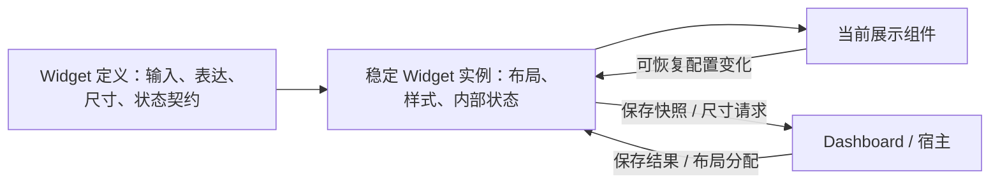

# Widget、展示组件与 Dashboard

状态：分层、状态归属和切换生命周期已确认；当前 Widget 样式已接受。本文是组件化的目标契约，公开 API、运行时校验与注册机制尚待实现。当前视觉以 [表达与尺寸](widget-expression-design.md)及 [Library](../assets/library-preview.html)为准。

## 三层职责

| 层次 | 负责 | 状态与边界 |
|---|---|---|
| Widget | 布局、样式、槽位、信息层级；选择合法表达与尺寸；协调内部展示；监听保存状态 | 同一实例持有表达选择、可恢复配置及保存状态；切换表达不重建整个 Widget |
| 展示组件 | Line、Bar、Progress、Ring、Gauge、Radar、Heatmap、Table 等的绘制与自身交互 | 接收明确数据和展示配置；向 Widget 上报需保留的变化；可独立用于 Card 或详情页 |
| Dashboard / 宿主 | 数据接入、实例增删、位置与网格排列、布局调整、导入导出、持久化 | 不管理每种图表的内部运行状态；保存时收集 Widget 快照并回传结果 |

简单文字、Typography、图标、简单状态可由 Widget 直接组合。坐标轴、图例、复杂 Tooltip、图形计算、表格交互等下沉到展示组件。Progress 和 Ring 可以独立成组件，不要求全部塞进一个包含大量分支的 Chart。

Widget 决定怎样组合和突出信息，展示组件决定如何绘制；无论内部复杂度如何，保存状态的协调都经过 Widget。运行时由固定代码执行，LLM 只在编码阶段按组件声明选择和适配。

## 消费者声明契约

数据生产方不决定 Widget 接受什么字段。Widget 定义作为数据消费者，声明自己的输入以及用法；展示组件也声明自身绘制所需的数据接口。适配层按照这些要求供数。

| Widget 定义应声明 | 用途 |
|---|---|
| 稳定类型标识、用途与示例 | 让没有上下文的实现者知道何时使用 |
| 输入形状、单位、字段含义与运行时校验 | 区分状态与活动、时间与类别、目标与分母、缺值与零 |
| 可用表达、各自数据前提与容量约束 | 紧凑 Widget 声明离散尺寸；图表声明最小尺寸和预设快捷项，切换时保留含义 |
| 槽位、主次信息与展示组件绑定 | 复用已接受样式，让不同图形有一致外框 |
| 可恢复状态及默认值、快照与恢复能力 | 状态不依赖 Dashboard 或当前 Chart 的挂载寿命 |
| 内部事件、保存反馈与尺寸协作边界 | 宿主不必理解各图表的内部机制 |

统一注册机制组织这些定义，不另写一套与定义脱节的匹配规则。输入校验由定义提供；公开入口调用它，不能把 TypeScript 类型检查当作对外部数据的运行时校验。具体导出名、参数形状及错误返回方式在实现时统一，不把本文的概念名称误报为已有 API。

成对量值、基准比较、状态历史与其他表达一并纳入这套组件契约，属于同一项组件化工作；不继续保留无法供数据的独立硬编码配方。

## 稳定实例与切换

一个 Widget 实例具有稳定身份，表达方式和尺寸不是实例身份。React 实现应保持外层组件类型与实例 key 稳定，不以 view 或 size 作为整张 Widget 的 key。

切换步骤：

1. Widget 根据自身定义与数据检查目标表达。
2. 在实例内保存当前表达的可恢复配置，保留共享状态与数据身份。
3. 选择目标表达；尺寸兼容时保持尺寸，不兼容时使用该表达的合法尺寸，并与宿主协作调整网格占位。
4. 替换内部展示组件，恢复其已有配置或使用声明的默认值。Widget 本身不卸载，不经 Dashboard 中转状态。
5. 在稳定外框内完成表达切换动画，外框尺寸与邻卡位置沿既定动效变化。

新展示组件可以需要挂载和接收内部配置；“不重新传递状态”指不要求宿主取回、拼装再灌入 Widget。状态留在稳定 Widget 实例中，由它完成内部绑定。没有共同含义的配置分别保留为各表达的配置，不能把雷达维度选择强行解释成折线的时间缩放。

只有删除实例、主动重置或恢复快照等显式生命周期操作才改变其状态基础。布局移动、普通重渲染、表达或尺寸切换不会隐式清空状态。

## 状态归属与保存

| 状态 | 运行时持有者 | 保存方式 |
|---|---|---|
| 选中的表达、用户选择的合法容量 | Widget | 包含在 Widget 快照；容量变化通知宿主分配占位 |
| 共享筛选及各表达需恢复的配置，如图例选择、缩放范围、表格排序 | Widget | 展示组件上报变化；切换表达仍保留 |
| 图表数值范围策略、自动 / 从零 / 完整百分比 / 自定义上下限 | Widget | 随快照持久化；自动范围在数据变化后重新计算 |
| Hover、当前 Tooltip、指针位置、动画进度 | 展示组件 | 临时状态，不进入快照 |
| 未保存、保存中、已保存、保存失败 | Widget 统一感知 | 根据内部变化和宿主保存结果更新 |
| Widget 的实例集合、x/y 和实际网格占位 | Dashboard | 随布局持久化，不充当图表状态的运行时存储 |
| 后端数据、查询与真实数据适配 | 宿主 / 数据层 | 按消费契约向 Widget 供数，Widget 不自行发明业务结果 |

Widget 的逻辑容量决定所需外框；Dashboard 持有实际布局位置和占位。双方通过尺寸协作关联，不各自决定一套尺寸。

宿主请求保存时，Widget 提供可序列化快照；宿主执行写入并告知结果。保存失败保留当前状态和修改；保存成功针对提交的快照确认，不清除保存期间产生的新修改。导出、导入或重新打开时，可以由宿主携带快照初始化实例；这与切换表达时把运行状态寄存在 Dashboard 是两回事。

Chart 不直接调用 Dashboard 的保存逻辑。Widget 不负责存储介质、文件导入导出或整个 Dashboard 的保存实现。暂存于内存的实例状态也不等于跨刷新持久化。

## 展示组件与过渡边界

Line、Bar、Progress、Ring、Gauge、Radar、Heatmap、Histogram 与 Table 是可独立消费的展示组件类别，不要求合并成一个庞大 Chart。组件负责图形计算、坐标轴、图例、读数反馈和内部交互；单个文字、图标或简单状态可以直接由 Widget 组合。

展示组件可以独立用于普通 Card 或详情页；由其调用方持有需要恢复的配置。在 Widget 内调用时，由稳定 Widget 实例承担这个职责。展示组件不依赖 Dashboard、网格倍数或 Widget ID。

Widget 外框、状态区和内部状态在表达切换时保持稳定，只有展示区域替换。尺寸和位置沿已有动效变化，reduced motion 遵循全局规则；不因组件化重新设计样式。具体形状和外框规则只在 [表达设计](widget-expression-design.md)维护。不同图形之间如何过渡由展示组件实现，不承诺任意图形节点直接插值。

## 当前代码与本轮边界

本轮整理文档，不修改组件或预览代码。

| 当前已有 | 尚待组件化落实 |
|---|---|
| 显式 WidgetData、familyViews、固定 React/SVG 展示和示意尺寸约束 | Widget 定义拥有完整公开契约、运行时校验和统一注册 |
| SemanticWidget 复用多数数据家族的渲染 | 稳定实例内的状态管理、保存反馈和表达切换生命周期 |
| 图形主要位于 semantic-widget / structured-widget-charts 内部函数，使用 React/SVG/HTML/CSS；当前这些示意未使用 D3.js | 可独立消费的展示组件及配置事件接口 |
| ExpressionDashboard 目前把表达选择放在 layout.channels.expressionView | 表达运行状态迁入 Widget；宿主只保留布局与保存快照的职责 |
| 成对量值、比较、历史已有已接受图稿 | 一并纳入数据接口与固定组件，不作为独立设计缺口 |

因此，当前页面证明视觉与交互样例已接受，不证明以上架构全部实现。后续验收需确认：切换不重挂载 Widget；状态不经 Dashboard 往返；每种展示独立可用；非法数据和非法组合被契约识别；保存反馈不因内部 Chart 替换而丢失。

[视觉与尺寸](widget-expression-design.md) · [Dashboard 布局](library/dashboard.md)
