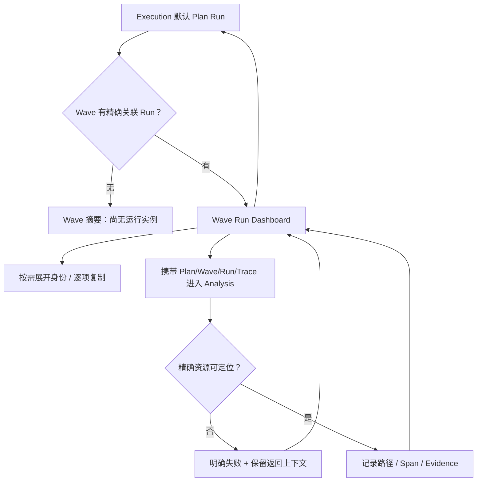

# 从执行前沿到精确证据

> 继承 U1 Execution 与 Analysis 导航；系统关联映射见领域文档。

1. Plan Run 先判断全 Task 哪个分支影响进展，再选择 Wave。原稿用 wave-1b 演示；生产应用到所有合法 Wave。
2. Wave Run 主要看产出、异常、前沿与下一个控制边界。元数据不是常驻指标面板。
3. Analysis 展示来自 Execution 的过滤范围；身份不全时不能换最近 Run。Span 查询必须经确切映射，不凭时间/名字推断。
4. 比较/读取只消费 owner 数据；遥测缺口不是无活动。若要纠偏，返回 Task 在 Input 描述意图。
5. 回 Wave 恢复 Task/Session、Workbench、选中节点和草稿，再回 Plan Run 恢复视口/过滤/选中 Wave。

取消动效时所有判断仍可完成。运行速度由可信 owner 信号提供，用户不在生产页点击切换快慢。追查失败不触发自动重跑。
