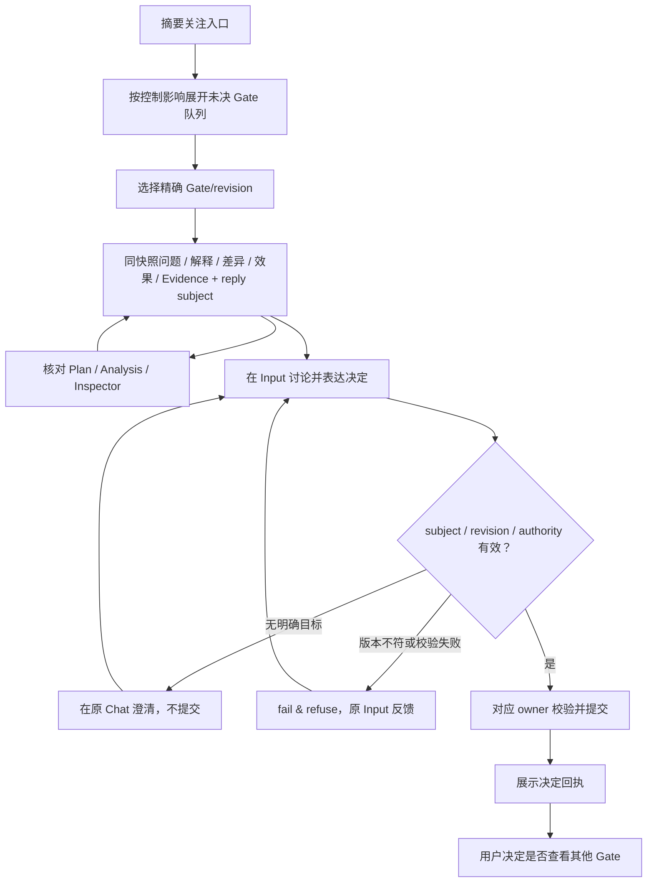

# 多 Gate 审核、证据与决定

> 继承 U1 Gate/subject/EvidenceRef 契约。

## 原子更新与导航

Gate 切换会一起更新问题、已确认决定、AI 理解、delta、效果、五个 EvidenceRef 和 reply subject；不允许新问题配旧链接。未发送内容沿用宿主 Composer 状态；提交边界校验目标与版本，旧版本指令拒绝而不自动换绑。

Plan 证据固定 Gate 实际引用的 revision/锚点并带 from_gate_id；Analysis 携带精确 Run/Trace 及按需 attempt/span/event；Inspector 保留左侧 Input 与 Gate subject。返回恢复队列位置、滚动和未提交内容，不依赖 browser history 猜测。

## 分支与异常

无 subject 的“同意”不能按最近 Gate 推断；清除 subject 只回 Task 级消息。旧 revision、不可读证据、不存在目标必须明确反馈，且不授权继续。完成后先展示回执，不自动选下一 Gate；满足原计划放行条件时沿 DAG 正常推进；若决定改变未来 Gate 的计划语义，则影响纳入当前决定，通过 Input 的 Plan IR 提案与校验/必要授权后提交新 Plan revision，再更新对应投影。独立并行 Gate 不另设相互改写流程（D09）。

预期注意力：当前问题及影响→已确认/候选解释的差异→授权后效果→必要证据→Input。候选选项只在 Input 讨论，不让右侧预设选项限制问题空间。

完整错误与返回行为引用 [查看器契约](../components/context-viewers.md)，恢复命令和宿主反馈引用 [Input 契约](../components/input-and-host-slots.md)，不在本流程另设恢复系统。
