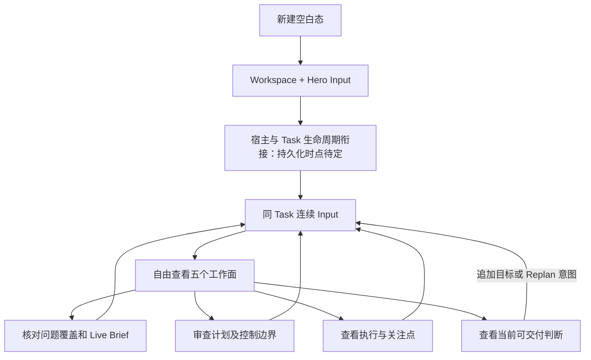

# Task 定义、计划与继续迭代

> 已接受的交互语义来自 U1；以下串联不是固定阶段。

## 场景 A：发现理解偏差

用户在 Grilling 看新增问题来源与 Brief，发现约束遗漏；回 Input 指出遗漏。系统生成受校验的候选变化，再投影新 Brief/delta。争议必须保留状态；图上无直接删除问题或批准 Brief。

## 场景 B：计划证据不足

Plan 摘要发现 proof/context readiness 缺口 → 打开精确 Plan 正文/DAG → 核对依赖/恢复边界 → 返回摘要 → Input 要求补证据或修改。浏览不批准计划；返回保留文档/图状态与 Task 草稿。

## 场景 C：结果可用但新增要求

Delivery 工作面显示当前可交付 → 查看候选及验收证据 → Input 追加目标 → 原判断失效并重新计算。Task 不因绿色判断永久关闭；新执行及复用 Task 的后台生命周期遵从系统 owner，不重写旧 Delivery 结果。

预期注意力：整体问题→异常→完整支撑→Input。每一场景都可能在任意工作面开始，没有自动顺序和完成勾选向导。
