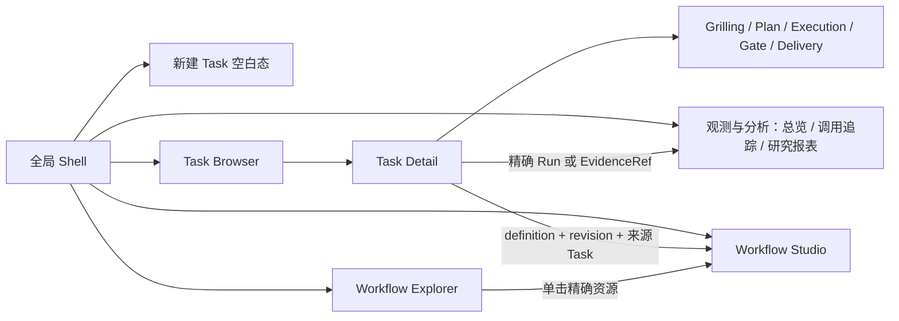

# 页面地图、路由与返回

> 继承：U1 全局及跨页契约。路由名是本包的逻辑标识，不是承诺 URL/API。Query key 仅在注明处来自现有原型。

## 信息架构

图表示浏览关系，不是 Workflow 状态机。Task Browser、Workflow Explorer、Studio、Analysis 不属于五工作面；DSH 主界面由品牌入口切换。

## 入口与负载

| 入口 | 目标 | 必须保留/提供的上下文 |
|---|---|---|
| `surface-banner` | DSH Harness 主界面 | 同宿主 workspace/current Task；宿主负责切换 |
| `new-task-action` | Hero Composer 空白态 | 暂存 Workspace；不因点击持久化 Task/Session |
| `all-tasks-action`（任务标题行三角图标，tooltip“全部任务”） | Task Browser | 全局 Shell；离开 Task 时保存草稿、subject、Workbench、下钻/滚动 |
| Task 行 | Task Detail | 精确 `task_id`；恢复该 Task 上次浏览和输入状态 |
| 五工作面导航 | Task 内投影 | 同 Task/Input；仅视图状态变化 |
| `all-workflows-action`（工作流标题行三角图标，tooltip“全部工作流”） | 全部 Workflow 浏览表面 | 独立 Workflow Browser 页面；与 Task Browser 共享浏览组件，单击资源进入对应工作台 |
| Workflow definition 行 | 对应 Workflow 上下文 | `workflow_definition_id`、精确 `revision`、来源 Task |
| Analysis 二级入口 | 总览 / 调用追踪 / 研究报表 | 当前 Task/Run 可作为初始范围，也允许跨 Task |
| `host-settings` | DSH settings | 宿主统一权限/模型/插件设置，不建第二设置中心 |

## Browser 组织（用户裁定 D01）

Task Browser 与 Workflow Browser（原称 Workflow Explorer）是两个独立页面，复用资源浏览布局与列表/Gallery、图标、元数据骨架、Context menu、多选/批量操作骨架。各自负责分类排序、领域字段、后台接口和生命周期。单击资源打开对应工作台。

优先 `/tasks?view=gallery`、`/workflows?view=list` 这样的独立路径加浏览 query；示例不冻结宿主前缀。两页浏览偏好独立恢复；Task Browser 当前查询、选择和管理操作已审核，见 [正式页面](../pages/task-browser.md)。具体 query schema、跨导航持久化与 Workflow 的管理规则继续接入设计。完整裁定见 [D01](../handoff/decisions-and-open-questions.md)。

## 精确下钻

| 路径 | 负载 | 返回与失败 |
|---|---|---|
| Plan 摘要→完整文档 / DAG | 当前 Plan 精确 revision；原型 `surface=plan`、`plan_view=document`、`plan_anchor` | DAG 与正文属于同一查看器；保存文档位置与图视口 |
| Execution Plan Run→Wave Run | `task_id`、`plan_run_id`、`wave_id`、`workflow_run_id`；definition/revision、trace identity | 无 Run 只看 Wave 摘要；不加载最近同名实例 |
| Wave→Analysis | 精确 Plan/Wave/Workflow Run/Trace Root 组合 | 展示“来自 Execution”范围；返回恢复下钻与视口 |
| Gate→Plan | 类型化 EvidenceRef；Gate 实际引用的 Plan revision、anchor、`from_gate_id` | 返回原 Gate、队列位置、reply subject、草稿 |
| Gate→Analysis | 上述 Run/Trace 组合；`from_gate_id`；按需 `attempt`、`span_id`、`event_id` | 返回来源 Gate；身份缺失/不存在显示无法定位 |
| Gate→Inspector | `ref_id`、`kind`、`gate_id`、revision + 该 renderer 的身份 | 保留当前 Gate subject；关闭恢复 Gate 主面 |

完整 EvidenceRef、revision 与 state 编码须经领域和宿主接口对齐。现有 HTML 的 Query 参数是语义示范；正式 host router 可以换载体，不能降低精确性。

## Return context（整理建议，非 schema 发布）

至少按 `task_id` 保存查看面、Plan/Wave 下钻、选中 Gate/revision、输入草稿/subject、各滚动区和图视口。跨页链接显式传递来源标识或宿主 return-context 引用，不能仅依赖浏览器 history；不要把草稿正文和敏感消息放 URL。

Task Browser 需恢复查询/过滤/排序/页位置/滚动；页面内状态规则已由 [Task Browser](../pages/task-browser.md#交互)确认，URL / 跨导航存储仍待接入。当前 v8 只有页面内状态，不能据此宣称已实现往返恢复。若返回对象已不再存在，保留可用草稿并显示无法恢复的具体对象；不替换成最新实例。后半句为整理建议，需纳入端到端恢复设计。

## 当前工作台原型入口

Workflow definition 行与 Workflow Explorer 已指向 [Studio v8](../assets/crystra-workflow-studio-v8.html)，保留 definition / revision / 来源参数；Task 的分析深链与 Sidebar 分析入口已指向 [Analysis v8](../assets/crystra-analysis-audit-v8.html)。这些页面内导航保留 URL 来源参数；完整会话、草稿与视口恢复仍由宿主接入完成。外部精确对象不在本地 fixture 中时展示未解析范围，不借用默认样例冒充查询成功。
